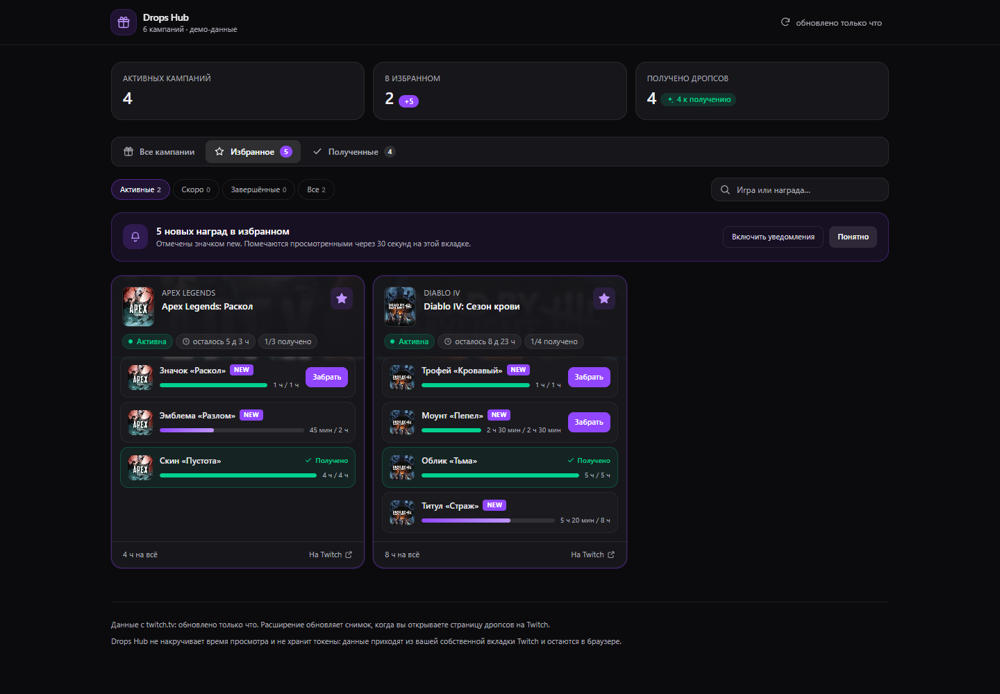
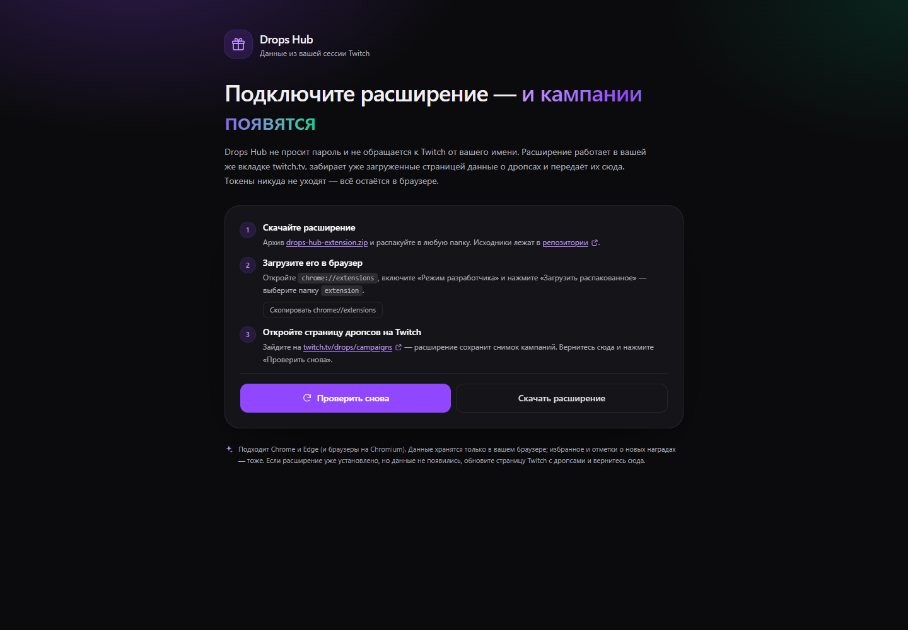

# Drops Hub

A dashboard for Twitch Drops campaigns: every campaign in one place, favourites with a heads-up when
new rewards appear, a separate tab for already claimed drops, search and filters.

Data comes from **your own twitch.tv tab** through a tiny companion extension — no passwords, no
tokens, no automation, nothing stored on a server.



## Why an extension

Twitch does not expose a public Drops API. The campaigns are rendered from an internal GraphQL field
(`currentUser.dropCampaigns`) that is protected by an integrity challenge — the same anti-bot measure
that keeps automated drops farming away. Drops Hub does not try to bypass it.

Instead, the extension simply reads the response **your own browser already received** when you open
the Drops page, and hands it to the dashboard. Your session stays yours: nothing is replayed, no
requests are forged, and no viewing time is simulated.



## Features

- **Every campaign in one list** — active, upcoming and expired, with per-drop progress and rewards.
- **Favourites** — a star on each card; a counter of new rewards, an "N new rewards" banner and a
  `new` badge on the specific drops.
- **Claimed** — a dedicated tab where collected rewards are highlighted in green.
- **Search and filters** — by game, campaign or reward name, plus a status filter.
- **Browser notifications** — about new rewards in favourites.
- **Local only** — favourites, "seen" marks and the last snapshot live in your browser.
- **Dark responsive UI** — from 320 px wide to wide desktop screens.

## Install

### Chrome, Edge, and other Chromium browsers

1. Open the deployed app (for example <https://twitch-drops-hub.vercel.app>) — it will offer the
   extension archive.
2. Download `drops-hub-extension.zip` and unpack it somewhere permanent.
3. Go to `chrome://extensions`, enable **Developer mode**, click **Load unpacked** and pick the
   unpacked `extension` folder.
4. Open <https://www.twitch.tv/drops/campaigns> — the extension captures the campaign snapshot.
5. Return to the app and press **Проверить снова**.

### Zen browser and Firefox

Zen is built on Firefox, so it needs the Firefox build of the extension (Firefox 140+, Zen 1.5+):

1. Download `drops-hub-extension-firefox.zip` from the app and unpack it.
2. Open `about:debugging#/runtime/this-firefox`, click **Load Temporary Add-on** and select
   `manifest.json` inside the unpacked folder.
3. Open <https://www.twitch.tv/drops/campaigns>, then return to the app and press **Проверить снова**.

Temporary add-ons disappear when the browser restarts. To keep it permanently, submit the zip to
[addons.mozilla.org](https://addons.mozilla.org/developers/) as a *self-distributed* add-on — Mozilla
signs it and gives you an `.xpi` you can install for good.

The extension source lives in [`extension/`](extension) with its own [README](extension/README.md).

## Local development

```bash
pnpm install
pnpm dev
```

The app runs on <http://localhost:3000>; the extension manifest already allows that origin, so the
whole flow can be tested locally. To preview the interface without installing anything, run it with
demo data:

```bash
DROPS_MOCK=1 pnpm dev
```

Production build:

```bash
pnpm build
pnpm start
```

There are no environment variables to configure.

## Deploying to Vercel

1. Push the repository to GitHub.
2. Import it at [vercel.com/new](https://vercel.com/new) — Next.js is detected automatically.
3. Open the assigned domain. The page is fully static, so no settings are required.

If you deploy under a different domain, add it to `host_permissions` and to the dashboard
`content_scripts.matches` in [`extension/manifest.json`](extension/manifest.json), then rebuild both
archives:

```powershell
powershell -ExecutionPolicy Bypass -File scripts/package-extension.ps1
```

## Project structure

```
src/
  app/
    page.tsx                  — dashboard entry (static page)
    globals.css               — Tailwind theme and base styles
  components/
    Dashboard.tsx             — tabs, filters, favourites, new-drop badges, notifications
    CampaignCard.tsx          — campaign card and drop rows
    Onboarding.tsx            — "connect the extension" screen
    Icons.tsx                 — inline SVG icons
  lib/
    bridge.ts                 — postMessage bridge with the extension + localStorage cache
    normalize.ts              — turns the captured GraphQL payload into the campaign model
    format.ts                 — duration, dates, plural forms
    mock.ts                   — demo data for DROPS_MOCK=1
    types.ts                  — shared types
extension/
  manifest.json               — MV3 manifest (Chromium + Firefox/Zen)
  capture.js                  — reads the page's own GraphQL response (MAIN world)
  bridge-twitch.js            — stores the snapshot in storage.local
  bridge-dashboard.js         — answers snapshot requests on the dashboard domain
public/
  drops-hub-extension.zip     — Chromium build served by the site
  drops-hub-extension-firefox.zip — Firefox / Zen build served by the site
scripts/
  package-extension.ps1       — builds both archives from extension/
```

## How it works

1. You open `twitch.tv/drops/campaigns`. Twitch's own frontend requests `ViewerDropsDashboard`.
2. `capture.js` (MAIN world) wraps `fetch`, sees that response and forwards the payload with
   `window.postMessage`. It never issues a request of its own.
3. `bridge-twitch.js` stores the payload in `chrome.storage.local`.
4. On the dashboard, `bridge-dashboard.js` answers the app's `postMessage` request with the stored
   payload; `normalize.ts` converts it into campaigns, drops and progress.
5. The last snapshot is cached in `localStorage`, so the page keeps working after a reload and even
   when `twitch.tv` is not open (until a newer snapshot arrives).

## Known limitations

- **Desktop browsers only** — Chromium (Chrome, Edge, Brave, …) loads the unpacked folder, Zen and
  Firefox load the temporary add-on. Mobile browsers have no extension support, so the app there
  shows only a snapshot previously synced in that browser.
- **Snapshot freshness** — data updates when you open the Twitch Drops page; the app cannot poll
  Twitch on its own.
- **Claiming happens on Twitch** — the "Забрать" button opens the campaign on twitch.tv; the app
  never sends claim mutations.
- **Per-device state** — favourites and "seen" marks live in `localStorage`, so devices do not share
  them.

## Privacy

The extension has no network permissions beyond the two hosts it runs on, keeps everything in
`chrome.storage.local`, and never touches credentials. The dashboard stores data in your browser and
has no backend at all.
